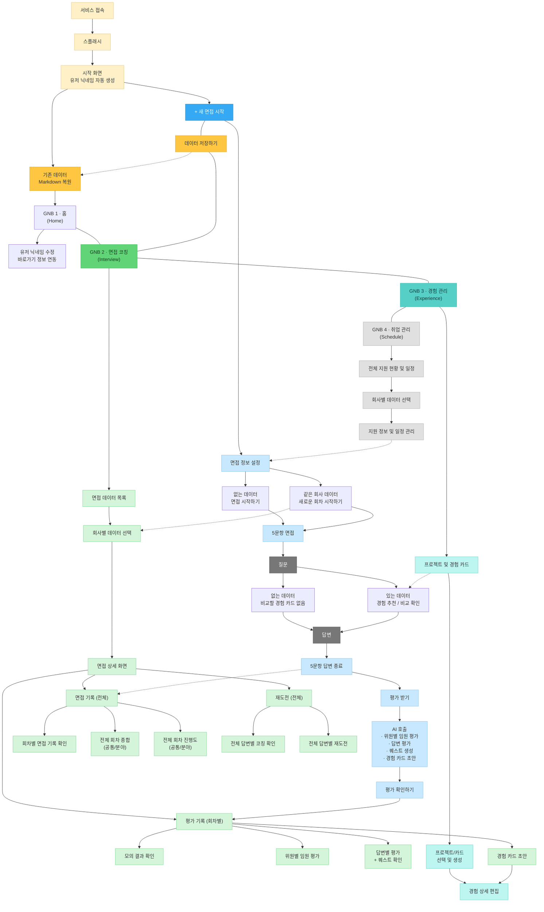

# 역전 취업 코칭 — IA & User Flow

> 기준일: 2026-11-02  
> 상태: IA 및 사용자 흐름 확정본  
> 서비스명: 역전 취업 코칭

---

## 1. 문서 개요

### 1.1 목적

본 문서는 역전 취업 코칭 서비스의 정보구조(IA), 사용자 흐름(User Flow), 화면 간 이동 관계 및 데이터 연동 관계를 정의한다.

서비스는 AI 모의면접을 중심으로 면접 기록, 평가 결과, 경험 카드, 취업 준비 정보를 연결한다.

### 1.2 다이어그램 표기 규칙

| 표기 | 의미 |
|---|---|
| 실선 화살표 (`-->`) | 화면 이동 및 사용자 행동 |
| 점선 화살표 (`-.->`) | 데이터 저장·참조·연동 |
| 노란색 | 서비스 진입 및 데이터 관리 |
| 파란색 | 면접 진행 |
| 초록색 | 면접 코칭 및 평가 기록 |
| 청록색 | 경험 관리 |
| 회색 | 취업 관리 |

### 1.3 GNB 구조

| GNB | 명칭 | 주요 역할 |
|---|---|---|
| GNB 1 | 홈 (Home) | 사용자 정보 및 주요 기능 바로가기 |
| GNB 2 | 면접 코칭 (Interview) | 면접 기록, 평가 기록, 재도전 |
| GNB 3 | 경험 관리 (Experience) | 프로젝트 및 경험 카드 관리 |
| GNB 4 | 취업 관리 (Schedule) | 지원 현황 및 일정 관리 |

### 1.4 공통 접근 기능

서비스 진입 이후 다음 기능에 접근할 수 있다.

- `+ 새 면접 시작`
- `데이터 저장하기`
- GNB 1 — 홈
- GNB 2 — 면접 코칭
- GNB 3 — 경험 관리
- GNB 4 — 취업 관리

공통 접근 기능은 별도의 중간 화면을 의미하지 않는다.

---

## 2. 통합 IA & User Flow



> **참고:** Mermaid는 노드 위치를 자동 배치하므로 원본 IA 이미지와 화면 배치가 다를 수 있다. 공통 GNB 연결은 순차적인 화면 이동이 아니라 서비스 내 공통 접근 관계를 표현한다.

---

## 3. Information Architecture

### 3.1 서비스 진입

| 화면 | 주요 기능 |
|---|---|
| 서비스 접속 | 서비스 진입 |
| 스플래시 | 서비스 시작 화면 표시 |
| 시작 화면 | 유저 닉네임 자동 생성 |
| + 새 면접 시작 | 신규 면접 진행 |
| 기존 데이터 Markdown 복원 | 기존 데이터 불러오기 |

### 3.2 GNB 1 — 홈 (Home)

| 화면 및 기능 | 설명 |
|---|---|
| 홈 | 서비스 메인 화면 |
| 유저 닉네임 수정 | 자동 생성된 닉네임 수정 |
| 바로가기 정보 연동 | 면접·경험·취업 관리 정보 연결 |

### 3.3 GNB 2 — 면접 코칭 (Interview)

#### 면접 데이터 목록

- 면접 데이터 목록
- 회사별 데이터 선택
- 면접 상세 화면

#### 면접 상세 화면

| 구분 | 하위 기능 |
|---|---|
| 면접 기록 (전체) | 회차별 면접 기록 확인 |
| | 전체 회차 종합 (공통/분야) |
| | 전체 회차 진행도 (공통/분야) |
| 평가 기록 (회차별) | 모의 결과 확인 |
| | 위원별 임원 평가 |
| | 답변별 평가 + 퀘스트 확인 |
| | 경험 카드 초안 |
| 재도전 (전체) | 전체 답변별 코칭 확인 |
| | 전체 답변별 재도전 |

### 3.4 GNB 3 — 경험 관리 (Experience)

| 화면 | 주요 기능 |
|---|---|
| 프로젝트 및 경험 카드 | 프로젝트와 경험 카드 목록 확인 |
| 프로젝트/카드 선택 및 생성 | 기존 항목 선택 또는 신규 생성 |
| 경험 상세 편집 | 경험 카드 상세 내용 작성 및 수정 |

### 3.5 GNB 4 — 취업 관리 (Schedule)

| 화면 | 주요 기능 |
|---|---|
| 전체 지원 현황 및 일정 | 전체 취업 준비 현황과 일정 확인 |
| 회사별 데이터 선택 | 지원 회사별 정보 선택 |
| 지원 정보 및 일정 관리 | 회사별 지원 정보와 일정 관리 |

---

## 4. 면접 진행 User Flow

### 4.1 새로운 면접 시작

```text
+ 새 면접 시작
    ↓
면접 정보 설정
    ↓
기존 회사 데이터 확인
    │
    ├── 없는 데이터
    │       ↓
    │   면접 시작하기
    │
    └── 같은 회사 데이터
            ↓
        새로운 회차 시작하기
            ↓
        5문항 면접
```

#### 주요 규칙

- 면접은 5문항으로 구성한다.
- 기존 회사 데이터가 없어도 면접을 시작할 수 있다.
- 같은 회사의 기존 데이터가 있으면 새로운 회차를 시작할 수 있다.
- 새로운 면접 회차는 기존 회차를 덮어쓰지 않고 누적한다.

### 4.2 질문 및 답변

```text
질문
    ↓
경험 카드 데이터 확인
    │
    ├── 없는 데이터
    │       ↓
    │   비교할 경험 카드 없음
    │
    └── 있는 데이터
            ↓
        경험 추천 / 비교 확인
            ↓
          답변
```

#### 주요 규칙

- 경험 카드가 없어도 면접을 진행할 수 있다.
- 경험 카드가 있는 경우 질문에 적합한 경험을 추천하거나 비교할 수 있다.
- 경험 카드는 답변 작성을 위한 참고 자료로 활용한다.
- 면접 질문·답변 진행 중에는 경험 카드를 조회·비교·참고할 수 있지만 생성하거나 수정할 수 없다.

### 4.3 면접 종료 및 AI 평가

```text
5문항 답변 종료
    ↓
평가 받기
    ↓
AI 호출
    ├── 위원별 임원 평가
    ├── 답변 평가
    ├── 퀘스트 생성
    └── 경험 카드 초안
    ↓
평가 확인하기
    ↓
GNB 2 · 면접 코칭
    ↓
해당 회사 면접 상세
    ↓
평가 기록 (회차별)
```

#### 주요 규칙

- 5문항 답변 종료 후 면접 기록에 질문·답변 데이터를 연동한다.
- 평가 받기 선택 시 AI 평가 및 후속 결과 생성을 요청한다.
- 평가 확인하기 선택 시 해당 회차의 평가 기록으로 이동한다.
- 평가 기록은 면접 회차별로 관리한다.

---

## 5. AI 평가 및 후속 결과

### 5.1 평가 결과

| 항목 | 설명 |
|---|---|
| 모의 결과 확인 | 해당 회차의 종합 평가 결과 |
| 위원별 임원 평가 | 평가위원별 평가 내용 확인 |
| 답변별 평가 | 질문별 답변 평가 및 피드백 |

### 5.2 후속 결과

| 항목 | 설명 |
|---|---|
| 퀘스트 | 평가 결과를 바탕으로 개선 행동 제안 |
| 경험 카드 초안 | 면접 답변을 기반으로 경험 카드 초안 생성 |

### 5.3 퀘스트 (Quest)

기존 프로토타입의 '역전의 실마리' 기능을 '퀘스트'로 변경한다.

#### 퀘스트 유형

**경험 강화**

- 실제 경험의 상황, 행동, 판단 근거, 결과 등을 보완한다.

**전달 강화**

- 면접 답변에서 경험과 역량을 구체적이고 설득력 있게 전달하도록 개선한다.

#### 주요 규칙

- 평가 결과에 따라 퀘스트를 생성한다.
- 답변별 평가에서 퀘스트를 확인할 수 있다.
- 퀘스트 수행은 선택 사항이다.
- 퀘스트 수행 여부는 면접 재도전 및 경험 카드 관리의 필수 조건이 아니다.

### 5.4 경험 카드 초안

```text
평가 기록 (회차별)
    ↓
경험 카드 초안
    ↓
GNB 3 · 경험 관리
    ↓
경험 상세 편집
    ↓
사용자 검토 및 수정
    ↓
사용자 확인 후 저장
```

#### 주요 규칙

- 경험 카드 초안은 AI가 면접 답변을 분석하여 생성한다.
- 생성된 초안은 경험 상세 편집 화면에서 검토한다.
- 사용자는 초안을 수정하거나 저장 여부를 결정할 수 있다.
- 사용자 확인 없이 기존 경험 카드를 자동으로 덮어쓰지 않는다.
- 경험 카드 초안과 정식 저장된 경험 카드는 구분하여 관리한다.

---

## 6. 면접 회차 및 재도전

### 6.1 새로운 면접 회차

새로운 면접 회차는 `+ 새 면접 시작`을 통해 생성한다.

```text
+ 새 면접 시작
    ↓
면접 정보 설정
    ↓
같은 회사 데이터 확인
    ↓
새로운 회차 시작하기
    ↓
새로운 5문항 면접
    ↓
기존 회사 데이터에 회차 누적
```

#### 주요 규칙

- 동일한 회사·직무·산업 분야의 기존 면접 데이터에 새로운 회차를 추가한다.
- 새로운 회차는 별도의 질문·답변·평가 기록을 가진다.
- 이전 회차의 기록은 보존한다.
- 전체 회차 종합 및 진행도에서 누적된 기록을 활용한다.

### 6.2 재도전

재도전은 새로운 면접 회차를 생성하지 않는다.

기존 질문과 답변을 바탕으로 개선 답변을 작성하고, 해당 답변의 개선 이력을 누적한다.

```text
GNB 2 · 면접 코칭
    ↓
면접 데이터 목록
    ↓
회사별 데이터 선택
    ↓
면접 상세 화면
    ↓
재도전 (전체)
    │
    ├── 전체 답변별 코칭 확인
    │
    └── 전체 답변별 재도전
            ↓
        개선 답변 작성
            ↓
        개선 이력 추가
```

#### 주요 규칙

- 재도전은 기존 면접 회차에 연결된다.
- 새로운 면접 회차를 생성하지 않는다.
- 기존 답변에 개선 이력을 추가한다.
- 최초 답변과 최초 평가 결과를 보존한다.
- 재도전 결과는 기존 평가 결과를 덮어쓰지 않는다.
- 사용자는 최초 답변과 개선 답변을 비교할 수 있다.

### 6.3 데이터 관계

```text
회사별 면접 데이터
│
├── 면접 회차 1
│   │
│   ├── 질문 1
│   │   ├── 최초 답변
│   │   ├── 최초 평가
│   │   └── 재도전 이력
│   │       ├── 개선 답변 1
│   │       ├── 개선 평가 1
│   │       ├── 개선 답변 2
│   │       └── 개선 평가 2
│   │
│   ├── 질문 2
│   ├── 질문 3
│   ├── 질문 4
│   └── 질문 5
│
└── 면접 회차 2
    │
    └── 새로운 5문항 면접
```

---

## 7. 화면 이동 및 데이터 연동

### 7.1 화면 이동 관계

| 출발 | 도착 | 구분 |
|---|---|---|
| 서비스 접속 | 스플래시 | 화면 이동 |
| 스플래시 | 시작 화면 | 화면 이동 |
| 시작 화면 | + 새 면접 시작 | 화면 이동 |
| 시작 화면 | 기존 데이터 Markdown 복원 | 화면 이동 |
| + 새 면접 시작 | 면접 정보 설정 | 화면 이동 |
| 면접 정보 설정 | 면접 시작하기 | 화면 이동 |
| 면접 정보 설정 | 새로운 회차 시작하기 | 화면 이동 |
| 5문항 답변 종료 | 평가 받기 | 화면 이동 |
| 평가 받기 | AI 호출 | 사용자 요청 및 처리 |
| 평가 확인하기 | 평가 기록(회차별) | 화면 이동 |
| 경험 카드 초안 | 경험 상세 편집 | 화면 이동 |

### 7.2 데이터 연동 관계

| 출발 | 도착 | 데이터 관계 |
|---|---|---|
| 새로운 회차 시작하기 | 기존 회사 데이터 | 회사별 면접 데이터 참조 |
| 5문항 답변 종료 | 면접 기록(전체) | 질문·답변 기록 누적 |
| 경험 카드 | 경험 추천 / 비교 확인 | 기존 경험 데이터 참조 |
| 지원 정보 및 일정 관리 | 면접 정보 설정 | 지원 회사 정보 참조 |
| 데이터 저장하기 | Markdown 복원 | 데이터 내보내기 및 복원 관계 |

### 7.3 공통 내비게이션 원칙

- GNB는 서비스 내부에서 공통으로 접근할 수 있다.
- GNB 1 홈은 하나의 화면이며 별도로 중복 생성하지 않는다.
- `+ 새 면접 시작`은 서비스 시작 화면과 내부 공통 기능에서 동일한 면접 시작 흐름으로 연결된다.
- `데이터 저장하기`는 서비스 내부 공통 기능으로 제공한다.
- 공통 기능은 별도의 중간 화면을 생성하지 않는다.

---

## 8. 데이터 관리 원칙

### 8.1 면접 데이터

- 면접 데이터는 회사·직무·산업 분야를 기준으로 관리한다.
- 같은 조건의 새로운 면접은 회차별로 누적한다.
- 각 회차의 질문·답변·평가 기록을 보존한다.
- 동일한 질문이 여러 회차에서 등장하더라도 각 회차의 답변은 별도로 보존한다.
- 면접 기록은 전체 회차 기준으로 확인한다.
- 평가 기록은 회차별로 확인한다.

### 8.2 재도전 데이터

- 재도전은 기존 질문·답변에 연결된다.
- 재도전 결과는 개선 이력으로 추가한다.
- 최초 답변과 평가 결과를 보존한다.
- 개선 답변과 개선 평가를 누적한다.
- 새로운 면접 회차와 재도전 이력은 구분하여 관리한다.

### 8.3 경험 데이터

- 프로젝트 및 경험 카드는 회사별 면접 데이터와 독립적으로 관리한다.
- 하나의 경험 카드를 여러 회사와 면접 질문에서 활용할 수 있다.
- 면접 진행 중에는 기존 경험 카드를 참조할 수 있다.
- 경험 카드 생성 및 수정은 경험 관리에서 수행한다.
- AI 경험 카드 초안은 사용자 검토 후 정식 저장한다.

### 8.4 취업 관리 데이터

- 전체 지원 현황과 일정을 관리한다.
- 회사별 지원 정보와 일정을 관리한다.
- 지원 회사 정보는 면접 정보 설정에서 참조할 수 있다.
- 취업 관리 데이터는 개별 면접 회차와 구분하여 관리한다.

### 8.5 Markdown 데이터

- 기존 Markdown 데이터를 불러올 수 있다.
- 사용자는 서비스 데이터를 Markdown으로 저장할 수 있다.
- 면접·경험·취업 관련 데이터의 연결 관계를 유지한다.
- Markdown 파일 저장과 서비스 내부 데이터 저장은 구분한다.
- 세부 파일 형식과 호환성은 데이터 모델 문서에서 정의한다.

---

## 9. 설계 원칙

1. 서비스는 면접부터 시작하거나 기존 데이터를 복원하여 이용할 수 있다.
2. 경험 카드 등록은 면접 시작의 필수 조건이 아니다.
3. 면접은 5문항으로 구성한다.
4. 새로운 면접 회차는 `+ 새 면접 시작`에서 생성한다.
5. 재도전은 새로운 회차를 생성하지 않고 기존 답변에 개선 이력을 추가한다.
6. 면접 기록과 평가 기록은 구분하여 관리한다.
7. 면접 기록은 전체 회차, 평가 기록은 회차별로 확인한다.
8. 경험 카드는 여러 회사의 면접에서 공통으로 활용할 수 있다.
9. AI 경험 카드 초안은 사용자의 확인 없이 정식 저장하지 않는다.
10. 퀘스트는 기존 프로토타입의 '역전의 실마리' 기능을 변경한 명칭이다.
11. GNB 4의 명칭은 `취업 관리 (Schedule)`을 사용한다.
12. 실선은 화면 이동, 점선은 데이터 연동을 의미한다.
13. 상세 데이터 구조와 AI 처리 규칙은 별도 기술 문서에서 정의한다.

---

## 10. 관련 문서

| 문서 | 역할 |
|---|---|
| `README.md` | 서비스 소개 및 프로젝트 안내 |
| `PRD.md` | 서비스 요구사항 및 MVP 범위 |
| `IA_UserFlow.md` | 정보구조 및 사용자 흐름 |
| `features/02-interview.md` | 면접 코칭 상세 기능 |
| `features/03-experience.md` | 경험 관리 상세 기능 |
| `features/04-strategy.md` | 취업 관리 상세 기능 |
| `technical/DATA_MODEL.md` | 데이터 구조 및 저장 규칙 |
| `technical/AI_RULES.md` | AI 평가 및 경험 분석 규칙 |
| `MIGRATION.md` | 기존 프로토타입 전환 계획 |

> 관련 문서의 파일명 및 경로는 실제 프로젝트 구조에 맞춰 관리한다.