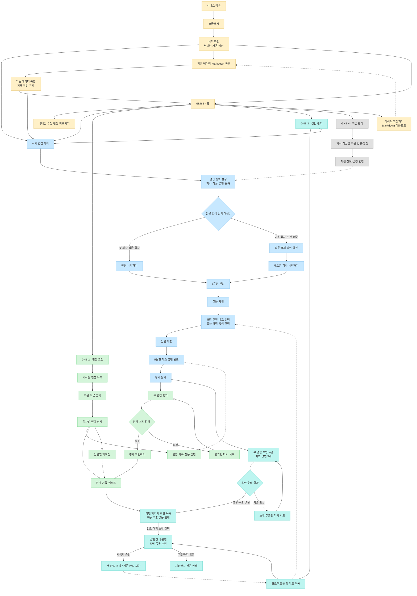

# 역전 취업 코칭 — IA & User Flow

> 기준 문서: PRD v2.2 / README.md (2026-11-02 개정)
> 기준일: 2026-11-02  
> 상태: 팀 검토용 개정안  
> 개발 기준: 기존 프로토타입 분석 후 확정

## 1. 문서 개요

### 1.1 목적과 범위

본 문서는 역전 취업 코칭의 정보구조(IA), 주요 화면 간 이동(User Flow), 조건별 분기와 데이터 참조 관계를 정의한다. 화면별 상세 기능·검증 조건은 `features/*.md`, 데이터 필드·버전·Markdown 직렬화는 `technical/DATA_MODEL.md`, AI 판정·추출 규칙은 `technical/AI_RULES.md`에서 관리한다. 본 문서에 표시한 화면·버튼은 설계 기준이며 기존 프로토타입 코드 분석 후 구현 방식과 화면 통합 여부를 확정한다.

서비스는 **면접부터 시작**하거나 **경험 관리부터 시작**할 수 있다. Markdown 복원은 별도 진입 기능이며 복원 자체로 새 면접 회차를 만들지 않는다. 두 경로가 면접을 시작하면 **4장 공통 면접 흐름**을 따른다.

### 1.2 다이어그램 표기 규칙

| 표기 | 의미 |
|---|---|
| 실선 화살표 (`-->`) | 화면 이동·사용자 행동 |
| 점선 화살표 (`-.->`) | 데이터 참조·연결(화면 이동 아님) |
| 노란색 | 서비스 진입·데이터 관리 |
| 파란색 | 면접 진행 |
| 초록색 | 평가·면접 기록 |
| 청록색 | 경험 관리·AI 초안 |
| 회색 | 취업 관리 |

다이어그램은 **핵심 화면 및 분기 요약**이다. 조건·실패·복원 상태는 4~8장의 흐름과 원칙을 우선 참조한다. Mermaid 자동 배치 순서는 실제 UI 배치나 단계의 필수 순서를 의미하지 않는다.

### 1.3 GNB 구조

| GNB | 명칭 | 주요 역할 |
|---|---|---|
| 1 | 홈 (Home) | 사용자 정보, 주요 기능 바로가기, 현황 요약 |
| 2 | 면접 코칭 (Interview) | 회사·직군별 면접 기록, 회차 평가, 재도전 |
| 3 | 경험 관리 (Experience) | 프로젝트, 경험 카드, AI 초안 검토·저장 |
| 4 | 취업 관리 (Schedule) | 회사별 우선순위, 회사·직군별 지원 현황·일정, 퀘스트 연결 |

공통 접근 기능은 `[+ 새 면접 시작]`, `[데이터 저장하기]`, GNB 네 영역이다. 공통 기능은 별도의 중간 화면을 반드시 생성한다는 뜻이 아니다. 면접 진행 중 GNB 노출·이탈 시 데이터 처리 방식은 기존 코드 분석 후 확정한다.

## 2. 통합 IA & User Flow



**주의:** 위 다이어그램의 `경험 상세 편집 → 저장`은 초안 검토 경로의 요약이다. 직접 작성한 경험 카드의 저장도 같은 편집 화면에서 가능하다. 평가 처리와 초안 추출은 **서로 독립적**이며, 성공 결과는 다른 처리의 실패 때문에 취소되지 않는다. 평가 결과 확인에 초안 추출 성공이 선행될 필요는 없다. `DRAFT_LIST`는 평가 기록에서 다시 접근할 수 있다.

## 3. Information Architecture

### 3.1 서비스 진입 및 공통 기능

| 영역/화면 | 주요 기능 | 연결 |
|---|---|---|
| 서비스 접속·스플래시 | 시작 화면 표시 | 시작 화면 |
| 시작 화면 | 닉네임 자동 생성, 시작 경로 선택 | 새 면접 / Markdown 복원 / 홈·GNB |
| `[+ 새 면접 시작]` | 새 회차 설정으로 진입 | 면접 정보 설정 |
| `[기존 데이터 Markdown 복원]` | 파일 불러오기, 데이터 복원 | 기존 기록·관리 화면 또는 새 면접(선택) |
| `[데이터 저장하기]` | 내보내기 범위 선택, Markdown 다운로드 | 현재 작업 화면 유지 |

### 3.2 GNB 1 — 홈

| 화면/기능 | 설명 |
|---|---|
| 홈 | 서비스 현황 및 주요 기능 바로가기 |
| 닉네임 수정 | 자동 생성된 닉네임 수정 |
| 기능 바로가기 | 새 면접, 면접 기록, 경험 관리, 취업 관리 접근 |

### 3.3 GNB 2 — 면접 코칭

| 계층 | 화면·영역 | 주요 내용 |
|---|---|---|
| 1 | 면접 데이터 목록 | 회사별 데이터 확인 |
| 2 | 회사 상세·지원 직군 | 회사 내 직군별 면접 기록 선택 |
| 3 | 회차별 면접 상세 | 유형·분야·질문 출제 방식, 진행 상태 |
| 4 | 면접 기록 | 회차별 질문·최초 답변, 전체 회차 종합·진행도(기존 기능 유지 검토) |
| 4 | 평가 기록 | 종합 결과, 위원별 평가, 답변별 평가, 퀘스트 발생 여부·개수·바로가기 |
| 4 | AI 경험 카드 초안 | 해당 회차 초안 목록·상태, 검토 화면 진입 |
| 4 | 재도전 | 질문별 개선 답변·재평가·버전 비교 |

### 3.4 GNB 3 — 경험 관리

| 화면·영역 | 주요 내용 |
|---|---|
| 프로젝트·경험 카드 목록 | 프로젝트별 복수 경험 카드, 검색·선택·직접 등록 |
| 경험 상세 편집 | 직접 작성, AI 초안 검토·수정, 신규 저장·기존 카드 보완 |
| AI 초안 목록(평가 기록에서 진입) | 검토 대기 / 저장 완료 / 저장하지 않음 상태 확인 |
| 변경 비교·확인 | 기존 경험 카드 보완 시 변경 사항 검토 후 저장 |

면접 중 경험 카드는 **조회·비교·선택·참고만 가능**하며 이 편집 화면으로의 생성·수정 동작은 제공하지 않는다. 초안 검토는 면접 평가 이후 별도의 경험 관리 흐름에서 수행한다.

### 3.5 GNB 4 — 취업 관리

| 화면·영역 | 주요 내용 |
|---|---|
| 전체 지원 현황 및 일정 | 회사·직군별 지원 상태와 일정 요약 |
| 회사 상세 | 회사별 우선순위 및 연결된 직군 |
| 회사·직군별 지원 정보 | 지원 현황, 일정 관리 |
| 퀘스트 연결 | 관련 경험 강화·전달 강화 퀘스트 확인·이동(선택) |

## 4. 면접 진행 User Flow

### 4.1 새 면접 시작 및 질문 출제 방식

```text
[+ 새 면접 시작]
  ↓
회사명·지원 직군·면접 유형 설정
  └─ 분야별 면접이면 분야 선택
  ↓
해당 회사·직군의 기존 회차 확인
  ├─ 첫 회차: 질문 출제 방식 숨김 → [면접 시작하기]
  └─ 이후 회차: 선택 가능한 질문 출제 방식 표시
       ├─ 새로운 문제만
       ├─ 섞어서
       └─ 똑같은 질문
            ├─ 같은 유형·분야의 이전 회차 선택
            └─ 과거 출제 질문에서 무작위 구성
       ↓
     [새로운 회차 시작하기]
  ↓
5문항 면접 진행
```

- **공통 면접:** 공통 질문 5문항. **분야별 면접:** 공통 2문항 + 선택 분야 3문항.
- 회차 번호는 **회사·직군별**로 누적하며 공통·분야별 면접을 합산한다. 동일 회사의 다른 직군은 별도 회차 집합이다.
- 첫 회사·직군 회차에서는 질문 출제 방식 선택 영역을 표시하지 않는다.
- '똑같은 질문 — 이전 회차 선택'은 현재 유형이 같고, 분야별 면접이면 분야도 같은 이전 회차만 허용한다.
- 과거 질문 무작위 구성은 공통 면접에서 **서로 다른 공통 질문 5개 이상**, 분야별 면접에서 **서로 다른 공통 질문 2개 이상 + 해당 분야 질문 3개 이상**이 있어야 한다.
- 각 질문 출제 방식은 필요한 기록·질문 조건이 충족될 때만 선택 가능하다. '새로운 문제만'·'섞어서'의 세부 출제 규칙은 PRD 및 `features/02-interview.md`를 따른다.
- 새 회차는 기존 회차를 덮어쓰지 않는다. **재도전은 새 회차가 아니다.**

### 4.2 질문·경험 선택·답변

```text
질문 확인
  ↓
기존 경험 카드 확인(선택)
  ├─ 카드 없음 → 경험 없이 답변
  └─ 카드 있음 → 규칙 기반 추천 / 비교 / 직접 선택 / 참고하지 않음
  ↓
답변 제출
  ↓
다음 질문으로 이동 → 총 5문항 최초 답변 완료
```

- 프로젝트·경험 카드가 없어도 면접을 진행할 수 있다.
- 경험 추천의 적합도와 실제 답변 평가 점수는 별개이다. 경험 참고 여부도 평가 점수와 별도로 기록한다.
- 질문·답변 진행 중 프로젝트·경험 카드 **등록·수정 불가**. 기존 카드의 조회·비교·선택·참고만 가능하다.
- 경험 카드의 원본 변경이 과거 면접 평가나 당시 참조 정보 스냅샷을 변경하지 않는다.

### 4.3 평가 요청과 독립 처리

```text
5문항 최초 답변 완료
  ↓
[평가 받기]
  ├─ A. AI 면접 평가
  │    ├─ 성공 → [평가 확인하기] → 해당 회차 평가 기록
  │    └─ 실패 → 평가 미완료 안내 → 평가만 [다시 시도]
  │
  └─ B. 최초 답변 5개 기반 AI 경험 카드 초안 생성
       ├─ 초안 있음 → 검토 대기 목록 연결
       ├─ 추출할 경험 없음 → 빈 상태 안내
       └─ 기술 오류 → 초안 생성만 [다시 시도]
```

- A와 B는 **독립적**이다. 한쪽의 성공 결과는 다른 쪽 실패로 삭제·초기화되지 않는다.
- 평가 실패 시 평가 완료로 표시하지 않는다. 초안 생성 실패가 정상 완료된 평가 결과의 열람을 막지 않는다.
- 평가 결과는 기존 프로토타입의 종합 평가·위원별 평가·답변별 평가를 기반으로 하며, 퀘스트 발생 여부·개수·바로가기 및 AI 초안 확인 진입을 추가한다.
- `[평가 확인하기]`는 해당 **회사·직군·회차**의 평가 기록으로 이동한다.

## 5. AI 평가·경험 카드 초안·퀘스트

### 5.1 평가 기록

| 영역 | 내용 |
|---|---|
| 종합 평가 | 해당 회차의 종합 결과 |
| 위원별 평가 | 기존 프로토타입의 평가위원별 평가 내용 |
| 답변별 평가 | 질문별 피드백·점수·심사평·잘한 점·보완할 점 |
| 퀘스트 | 발생 여부·개수·관련 퀘스트 바로가기 |
| 경험 카드 초안 | 해당 회차의 초안 목록·상태·검토 진입 |

AI 면접 평가의 직접 대상은 **사용자가 제출한 답변**이다. 카드에만 존재하고 실제 답변에 포함되지 않은 정보나 카드 완성도를 점수 근거로 사용하지 않는다.

### 5.2 경험 카드 초안 검토

```text
평가 기록(회사·직군·회차)
  ↓
[이번 회차의 경험 카드 초안 확인하기]
  ↓
프로젝트별 초안 목록·처리 상태
  ├─ 초안 없음(정상 추출 결과) → 안내 + [경험 관리로 이동]
  ├─ 기술 오류 → [다시 시도]
  └─ 검토 대기 초안 선택
       ↓
     경험 관리 → [경험 상세 편집]
       ↓
     근거 질문·답변·하이라이트 확인 / 분류·내용 검토·수정
       ├─ 새 경험 카드로 저장 → 저장 완료
       ├─ 기존 경험 카드 보완 → 변경 비교·승인 → 저장 완료
       └─ 저장하지 않기 → 저장하지 않음
       ↓
     다른 초안 검토 또는 평가 기록 복귀
```

- AI 분석 대상은 **해당 회차의 최초 답변 5개**이며, 재도전 답변을 자동으로 재분석하지 않는다.
- AI는 프로젝트 초안과 개별 경험 카드 초안을 함께 생성한다. 같은 프로젝트의 서로 다른 경험은 분리하고, 여러 답변의 같은 경험은 하나의 카드 초안으로 묶을 수 있다.
- 각 초안은 출처 질문·답변 및 추출 근거 부분과 연결된다. 답변에 없는 역할·성과·수치를 임의 생성하지 않는다.
- 프로젝트를 식별할 수 없는 경우 `프로젝트 미지정`, 일부 정보가 없으면 `추가 작성 필요`로 표시한다. 경험 자체가 식별되지 않으면 임의 카드 초안을 생성하지 않는다.
- 사용자는 프로젝트 분류와 경험 내용을 검토·수정할 수 있다. 프로젝트 초안은 확인 후 정식 저장하거나 기존 프로젝트에 연결할 수 있다.
- **초안 상태:** `검토 대기` / `저장 완료` / `저장하지 않음`. 일부만 저장해도 다른 초안 상태는 유지한다.
- 검토 대기 초안은 이후 평가 기록에서 다시 접근할 수 있다. 사용자의 명시적 저장 전에는 정식 프로젝트·경험 카드가 아니다.
- 기존 카드 보완 시 변경 내용을 비교·확인하고 저장한다. 자동 덮어쓰기는 금지한다.
- 초안 저장 여부는 당시 면접 최초 답변·평가 결과를 변경하지 않는다.

### 5.3 퀘스트

기능명은 **퀘스트**로 통일하고 유형은 다음 두 가지로 유지한다.

| 유형 | 내용 |
|---|---|
| **경험 강화** | 경험의 상황·행동·판단 근거·결과를 작성·보완 |
| **전달 강화** | 면접 답변에서 경험·역량을 구체적이고 설득력 있게 설명하도록 개선 |

- 평가 결과에 따라 필요한 유형의 퀘스트를 제안한다. 두 유형을 모두 수행할 필요는 없다.
- 퀘스트 수행은 선택이며 면접 재도전·경험 카드 저장의 선행 조건이 아니다.
- **경험 카드 ≠ 활용 답변 ≠ 퀘스트**: 각각 독립 데이터로 관리한다.

## 6. 면접 회차 및 재도전

### 6.1 회사·직군·회차 계층

```text
회사
  ├─ 지원 직군 A
  │    ├─ 면접 회차 1 (공통 또는 분야별)
  │    │    ├─ 질문 1~5 / 최초 답변·최초 평가
  │    │    ├─ AI 경험 카드 초안·처리 상태
  │    │    └─ 질문별 재도전 답변·평가 버전
  │    └─ 면접 회차 2 (공통 또는 분야별)
  └─ 지원 직군 B
       └─ 면접 회차 1
```

- 회차 번호는 **회사·직군** 단위로 누적한다. 공통 면접과 분야별 면접은 같은 번호 체계를 공유한다.
- 각 회차의 면접 유형·분야·질문·최초 답변·평가 기록은 보존한다.
- 전체 회차 종합·진행도는 기존 프로토타입 기능을 유지하는 방향으로 검토하되 집계 기준은 코드 분석 후 확정한다.

### 6.2 재도전 흐름

```text
면접 코칭 → 회사 → 직군 → 회차별 평가·답변 기록
  ↓
재도전할 질문 선택
  ↓
최초 답변·피드백 확인
  ↓
개선 답변 작성·제출
  ↓
새 답변에 대한 AI 재평가
  ↓
기존 질문의 재도전 버전으로 저장
  ↓
최초·재도전 답변과 평가 비교
```

- 재도전은 기존 회차의 **해당 질문에 답변·평가 버전**을 추가하며 새 면접 회차를 생성하지 않는다.
- 최초 답변·최초 평가를 보존하고 기존 평가를 덮어쓰지 않는다.
- 개선 비교의 기준은 **같은 회차 내 답변·평가 이력**이며, 다른 회차 최고점과의 비교 규칙을 혼동하지 않는다.
- AI 경험 카드 초안의 기본 추출 근거는 재도전 결과가 아닌 **최초 답변 5개**다.

## 7. 화면 이동 및 데이터 연동

### 7.1 주요 화면 이동

| 출발 | 도착 | 조건·행동 |
|---|---|---|
| 시작 화면·공통 기능·경험 관리 | 면접 정보 설정 | `[+ 새 면접 시작]` |
| 면접 정보 설정 | 면접 질문 | 회차 생성 및 시작 |
| 시작 화면 | 기존 기록·관리 화면 | Markdown 복원 완료; 자동 회차 생성 없음 |
| 5문항 답변 완료 | AI 처리 상태 | `[평가 받기]` |
| 평가 처리 성공 | 해당 회차 평가 기록 | `[평가 확인하기]` |
| 해당 회차 평가 기록 | 해당 회차 AI 초안 목록 | `[이번 회차의 경험 카드 초안 확인하기]` |
| 검토 대기 초안 | 경험 상세 편집 | 초안 선택 |
| 경험 상세 편집 | 기존 카드 변경 비교 | 기존 카드 보완 선택 시 |
| 평가·답변 기록 | 재도전 입력 | 질문별 재도전 선택 |
| 공통 기능 | 내보내기 범위 선택·다운로드 | `[데이터 저장하기]` |

### 7.2 주요 데이터 참조 관계

| 원천 | 참조·연결 위치 | 관계 |
|---|---|---|
| 회사·직군별 기존 회차 | 면접 설정 | 다음 회차 번호·출제 방식 활성화 |
| 저장 완료 경험 카드 | 면접 질문 | 규칙 기반 추천·비교·선택·참고 |
| 최초 답변 5개 | AI 평가·경험 추출 | 각각 독립 처리 |
| 면접 회차 | 평가·재도전·AI 초안 | 당시 회차 기준 연결 |
| AI 초안 | 경험 상세 편집 | 검토 후 신규 카드 또는 기존 카드 보완 |
| 취업 관리의 회사·직군 정보 | 면접 정보 설정 | 회사·지원 직군 정보 참조 |
| 퀘스트 | 평가 기록·취업 관리 | 관련 평가·경험·답변과 연결하되 독립 관리 |
| Markdown 백업 파일 | 복원 후 작업 데이터 | 저장 시점 데이터·상태 복구 |

### 7.3 공통 내비게이션 원칙

- GNB는 홈·면접 코칭·경험 관리·취업 관리의 네 영역이다. 홈 화면을 중복 생성하지 않는다.
- `[+ 새 면접 시작]`은 어디서 실행해도 같은 면접 정보 설정 흐름으로 연결된다.
- `[데이터 저장하기]`는 공통 기능이며 Markdown 다운로드와 내부 데이터 변경을 혼동하지 않는다.
- 화면 이동과 데이터 참조는 구분한다. 데이터 참조만으로 화면이 자동 이동하지 않는다.

## 8. 데이터 관리 및 Markdown 흐름

### 8.1 데이터 소유·보존 원칙

- **회사** 단위로 우선순위를 관리한다. **회사·직군** 단위로 지원 현황·일정을 연결한다.
- 면접 회차는 회사·직군 단위로 누적한다. 재도전은 질문별 버전이다.
- 프로젝트·경험 카드는 회사·면접 회차와 독립적으로 관리하며 여러 면접에서 재사용할 수 있다.
- 평가 리포트는 평가 당시 답변과 관련 경험 참조 버전을 유지한다. 이후 경험 카드 수정으로 과거 점수를 변경하지 않는다.
- AI 초안은 정식 경험 카드와 분리되며, 검토 대기·저장 완료·저장하지 않음 상태를 유지한다.

### 8.2 Markdown 내보내기

```text
[데이터 저장하기]
  ↓
내보내기 범위 선택
  ├─ 경험 관리만
  ├─ 경험 + 면접 통합
  └─ 면접 기록만
  ↓
Markdown 파일 다운로드
  ↓
현재 작업 화면 유지
```

| 범위 | 포함 내용(요약) |
|---|---|
| 경험 관리만 | 정식 프로젝트·저장된 경험 카드·태그·연결 퀘스트(선택) |
| 경험 + 면접 통합 | 경험 관리 데이터, 회사·직군·회차·질문·최초 답변·평가·재도전·퀘스트, 진행 중 면접, AI 초안 상태 |
| 면접 기록만 | 회차·질문·답변·평가 및 재도전 이력 |

- 통합 내보내기에는 `검토 대기` 초안의 **내용과 상태**를 포함한다.
- `저장하지 않음` 초안은 통합 내보내기에 **상태만** 기록하고 내용은 포함하지 않는다.
- `검토 대기` 초안은 **경험 관리만** 내보내기에 포함하지 않는다.
- 진행 중인 면접은 통합 내보내기에 미완료 상태를 표시한다. 질문 단위 복원·재개 방식은 코드 분석 후 확정한다.

### 8.3 Markdown 복원

```text
[기존 데이터 Markdown 복원]
  ↓
Markdown 파일 선택·불러오기
  ↓
지원 가능한 데이터·상태 복원
  ↓
기존 기록 확인 / 경험 관리 / 취업 관리 / 새 면접 시작(선택)
```

- 복원 자체로 새 면접 회차를 생성하지 않는다.
- 백업에 포함된 회차·질문·답변·평가·재도전, 정식 경험 데이터, 취업 관리 정보, AI 초안 상태를 유지한다.
- 복원된 `검토 대기` 초안은 다시 검토할 수 있다.
- 기존 Markdown 형식과 신규 구조의 호환성, 미완료 면접의 정확한 재개 동작은 기존 코드 분석 후 확정한다.

### 8.4 수동 저장 원칙

- Markdown 내보내기는 **사용자가 실행하는 파일 다운로드**이며 서비스 내부 저장이나 자동저장이 아니다.
- 현재 작업 데이터에 반영된 변경 사항도 Markdown을 다시 내려받지 않으면 백업에 포함되지 않는다.
- 브라우저·작업 세션 종료 시 백업하지 않은 데이터가 소실될 수 있다.
- 세부 저장 포맷과 데이터 스냅샷 구조는 `technical/DATA_MODEL.md`에서 정의한다.

## 9. 설계 원칙 및 검토 대기 항목

### 9.1 확정 설계 원칙(PRD v2.2 기준)

1. 면접 시작과 경험 관리 시작은 독립된 진입 경로다.
2. 경험 카드 등록은 면접 시작의 필수 조건이 아니다.
3. 면접 중 경험 카드는 조회·비교·선택·참고만 가능하다.
4. 공통 면접 5문항, 분야별 면접 공통 2문항+분야 3문항이다.
5. 회사·직군별로 회차를 누적하고 공통·분야별 면접의 회차 번호를 공유한다.
6. 재도전은 기존 회차의 질문별 답변·평가 버전이다.
7. 면접 평가와 AI 경험 카드 초안 추출은 독립 처리한다.
8. AI 초안은 최초 답변 5개를 근거로 생성하며 사용자 승인 전 정식 저장하지 않는다.
9. 기능명은 **퀘스트**, 유형명은 **경험 강화·전달 강화**다. 수행은 선택 사항이다.
10. Markdown 복원은 신규 회차를 자동 생성하지 않으며 내보내기는 수동 다운로드다.
11. 실선은 이동, 점선은 데이터 참조를 뜻한다.

### 9.2 기존 프로토타입 분석 후 확정할 항목

- 기존 평가 결과·전체 회차 종합·진행도 화면의 재사용 및 배치
- 진행 중 면접의 질문 단위 저장·복원·재개 방식
- 기존 Markdown 파일과 새 데이터 구조의 호환·전환 처리
- 공통 GNB 노출 및 면접 진행 중 이탈 시 데이터 처리
- 프로젝트 미지정 경험 카드의 정식 저장 시 프로젝트 연결 정책
- 실제 화면 수·컴포넌트 통합·상세 UI 위치

위 항목은 **미확정**이며 본 문서의 화면 흐름이 구현 완료를 뜻하지 않는다.

## 10. 관련 문서

| 문서 | 역할 |
|---|---|
| `README.md` | 서비스 소개, 시작 경로, 문서 안내 |
| `PRD.md` | 서비스 요구사항·MVP·정책 기준 |
| `IA_UserFlow.md` | 정보구조·화면 이동·데이터 연동(본 문서) |
| `features/01-home.md` | 홈·서비스 시작·빠른 진입 |
| `features/02-interview.md` | 면접 설정·진행·평가·재도전 |
| `features/03-experience.md` | 프로젝트·경험 카드·AI 초안 검토 |
| `features/04-schedule.md` | 취업 관리·회사·직군·일정·퀘스트 |
| `technical/DATA_MODEL.md` | 데이터 관계·버전·스냅샷·Markdown 포맷 |
| `technical/AI_RULES.md` | 추천·AI 평가·경험 추출·퀘스트 규칙 |
| `MIGRATION.md` | 기존 프로토타입 전환 계획 |

> 실제 개발 반영 전 PRD v2.2 및 기능별 문서와 교차 검토하고, 기존 코드 분석 결과에 따라 미확정 항목을 갱신한다.